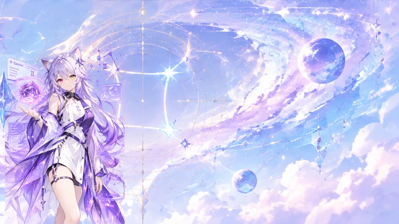
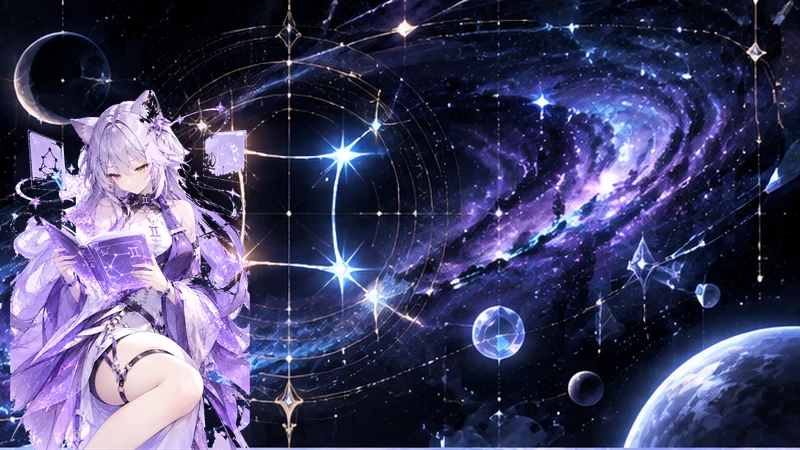

# Gemini Starlight Neko (dsh-skin-gemini)

> A Gemini-themed custom skin plugin for **DeepSeek Harness (DSH) Web GUI**: Featuring celestial star chart & armillary sphere background, futuristic blue-purple UI overlay, and day/night anime neko girl character standees.

This is a pure client-side display-layer plugin for DeepSeek Harness. It sets the `data-dsh-gemini-skin` scope attribute on `apply()`, automatically switches background art and character standees based on light/dark theme, and mounts character artwork in an independent overlay layer. Its effect cleanup function fully restores all modified CSS variables and DOM elements upon unmount. It introduces no server-side services, emits no Cordis events, and does not touch model requests.

---

## ✨ Features

- **Day & Night Anime Neko Standees**:
  - **Light Mode (Day)**: Features the *Holographic Neko Wizard* holding a glowing holographic celestial star-cube.
  - **Dark Mode (Night)**: Features the *Purple Celestial Chart Neko Girl* holding an ancient Gemini star chart manuscript with soft ambient lighting.
- **Panoramic Gemini Star Chart & Nebula Background**:
  - Celestial armillary sphere and Gemini constellations positioned on the right side, with high-transparency left-side spacing for optimal chat bubble readability.
- **Gemini Tech Blue-Purple UI Overlay**:
  - Aurora Purple (`#7b68ee`) × Lavender Soft Purple × Dawn Crystal White token coverage, fully aligned with native DSH design variables.
- **Holographic Starlight Favicon**:
  - Custom starlight diamond favicon matching the character's hair accessory, automatically applied to browser tabs upon skin activation.
- **Futuristic Corner Accents** (`gemini-corners`).
- **Fully Offline & Self-Contained**:
  - All media assets are compressed to WebP/PNG data URIs and embedded at build-time. Single file distribution (`lib/client.js`, ~1.28 MB) with **zero external network requests**.

---

## 🎨 Preview

| Light Mode (Day) | Dark Mode (Night) |
| :---: | :---: |
|  |  |

---

## 📦 Installation

### Method 1: DSH Plugin Manager (Offline Zip Import)
1. In the DSH Web GUI, go to **Settings → Third-Party Plugin Manager** (`设置 → 第三方插件管理`).
2. Click **Offline Import** (`离线导入`) and select the exported zip package `dsh-skin-gemini-starlight-neko.zip`.
3. Restart the DSH server to take effect.

### Method 2: Local Directory CLI Installation
Run the following command in your terminal:
```bash
dsh plugin --profile web add '/path/to/dsh-skin-gemini'
```
After installation, restart the DSH server once and confirm enablement in **Settings → Plugins**.

---

## 📁 Repository Structure

```text
dsh-skin-gemini/
├── package.json          # Plugin manifest & dsh.client configuration
├── skin.json             # Skin registry metadata read by DSH Skin Manager
├── cordis.patch.yml      # Cordis plugin registry patch file
├── gemini.css            # Skin core stylesheet & CSS tokens
├── build_client.py       # Python build script (WebP compression & asset inlining)
├── verify_assets.py      # Self-test validator for embedded asset consistency
├── lib/
│   ├── index.js          # Host entry point (empty apply stub)
│   └── client.js         # Self-contained bundled client script
├── assets/               # Raw and processed image assets
│   ├── bg-light.png      # Light mode background art
│   ├── bg-dark.png       # Dark mode background art
│   ├── character-light.png # Light mode character standee (transparent RGBA)
│   ├── character-dark.png  # Dark mode character standee (transparent RGBA)
│   └── favicon.png       # Starlight icon
└── preview/              # Theme previews
    ├── light.webp
    └── dark.webp
```

---

## 🛠️ Replacing Backgrounds or Character Artwork

Since assets are **inlined as data URIs** inside `lib/client.js` during build time, updating artwork requires replacing the image in `assets/` and re-running the build script:

1. Replace files under `assets/` using the exact same filenames (`bg-light.png`, `bg-dark.png`, `character-light.png`, `character-dark.png`, `favicon.png`).
2. Run the python build script (requires `Pillow` installed):
   ```bash
   python build_client.py
   ```
3. Run the asset self-check script:
   ```bash
   python verify_assets.py
   ```
4. Restart the DSH server.

---

## 📄 License

This project is licensed under [CC-BY-NC-SA-4.0](https://creativecommons.org/licenses/by-nc-sa/4.0/).
